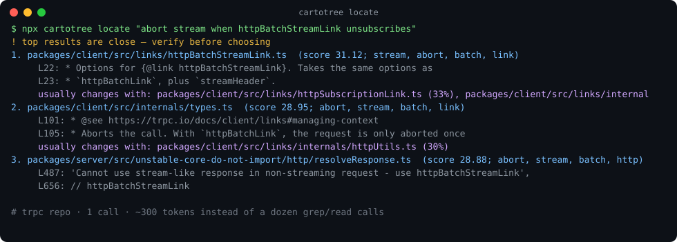

# 🌲 cartotree

> Tell your coding agent which files to open first. Fewer grep calls, fewer tokens, same answers.

[](https://www.npmjs.com/package/cartotree)
[](./LICENSE)

Ask an agent "why does this bug happen?" and it usually runs grep dozens of times and reads whole files before it finds where to look. cartotree keeps a local index of your repo and answers that first question directly: a ranked list of files with the matching lines as evidence. Works with Claude Code, Cursor, Codex and anything that speaks MCP.



```bash
npx cartotree init    # installs a skill + MCP server for your agent (shows every change, --dry-run to preview)
```

---

## What the agent gets

Three commands, each returning a few lines instead of a wall of grep output:

```bash
npx cartotree locate "abort JSONL stream on httpBatchStreamLink unsubscribe"   # which files to open first
npx cartotree peek packages/client/src/links/httpBatchStreamLink.ts abort unsubscribe   # only the matching lines
npx cartotree links httpBatchStreamLink        # where a symbol is defined and called
npx cartotree links src/foo.ts                 # imports, importers, files usually changed with it (git)
```

## Setup

```bash
npx cartotree init            # skill + MCP server + SessionStart reminder (shows every change)
npx cartotree init --dry-run  # preview only
```

Or as a Claude Code plugin:

```bash
claude plugin marketplace add kingluminance/cartotree
claude plugin install cartotree@cartotree
```

The MCP server (`npx cartotree mcp`) exposes `cartotree_locate`, `cartotree_peek` and `cartotree_links`.
After the first call the index stays in memory (~10 ms per lookup). An on-disk cache in `.cartotree/` is keyed by git HEAD and your uncommitted changes.

## How locate ranks files

BM25F over four fields of every source file: path words, exported names, code identifiers (scored per function so one matching function is not diluted by a long file) and **past commit messages that touched the file**. Plus light stemming, an import-neighbor boost, 1–2 evidence lines per result, a warning when the top results are close, and "usually changes with" from git co-change history. No LLM, no network.

---

## Benchmark

[deepseek-harness](https://github.com/deepseek-ai/deepseek-harness) (21,632 files). Questions are real commit messages ("which files were changed?"), answered by a Claude Haiku agent with cartotree vs. the same agent with only ls/find/grep. Each setup was run twice and averaged. Git history was cut off before the test commits so the tool cannot see the answers.

**Fast mode, 15 questions** (default)

| | grep only | cartotree |
|---|---|---|
| right file in top 3 | 13.5 / 15 | 14 / 15 |
| right file ranked 1st | 12 / 15 | 11 / 15 |
| tool-output tokens | ~37k | ~7.5k (**−80%**) |
| total agent tokens | ~153k | ~100k (**−35%**) |
| time | ~130 s | ~45 s (**−66%**) |

**Careful mode, 30 questions** (agent verifies with `peek` before answering)

| | grep only | cartotree |
|---|---|---|
| right file ranked 1st | 22 / 30 | 22.5 / 30 |
| right file in top 3 | 25.5 / 30 | 24.5 / 30 |
| tool-output tokens | baseline | **−63%** |
| time | baseline | **−17%** |

Accuracy is on par with grep (within ±1.5 questions); the gain is cost and speed. One thing we tried and reverted: telling the agent to "answer immediately when confident" made it list fewer candidates and lowered top-3 accuracy.

---

## Annotated directory trees

The original cartotree command still works: a compact, annotated map of your codebase to paste into any AI chat.

### The problem it started with

When you paste your project structure into an AI assistant, two things happen:

1. **Token waste** — Raw `tree` output burns hundreds of tokens on ASCII box characters with zero semantic value.
2. **Hallucination** — AI has no idea what each folder *does*, so it guesses wrong.

### The Solution

cartotree generates a compact, annotated map of your codebase — folder descriptions, exported functions, and an AI-optimized serialization format that fits your architecture into a fraction of the tokens.

---

### Quick Start

```bash
npx cartotree
```

No install required.

---

### Output Formats

### Default — Annotated ASCII Tree
```
my-app/
├── src/                    # Core application source
│   ├── components/         # Reusable UI components
│   │   ├── Button.tsx      <Button, ButtonProps>
│   │   └── Modal.tsx       <Modal, useModal>
│   ├── hooks/
│   │   └── useAuth.ts      <useAuth, useUser>
│   └── services/
│       └── api.ts          <fetchUser, postData>
└── package.json
```

### `--ai` — Token-Optimized Serialization
```
# cartotree fmt: name{desc}[children]<exports>
my-app{Core application source}[src{Core application source}[components{Reusable UI components}[Button.tsx<Button,ButtonProps>,Modal.tsx<Modal,useModal>],hooks[useAuth.ts<useAuth,useUser>],services[api.ts<fetchUser,postData>]],package.json]
```

### `--json` — JSON Format
```json
{
  "my-app": {
    "src": {
      "_desc": "Core application source",
      "components": {
        "Button.tsx": ["Button", "ButtonProps"],
        "Modal.tsx": ["Modal", "useModal"]
      }
    }
  }
}
```

---

### Usage

```bash
# Default annotated ASCII tree
npx cartotree

# AI-optimized single-line serialization
npx cartotree --ai

# JSON format
npx cartotree --json

# Copy to clipboard (paste directly into AI)
npx cartotree --ai --copy

# Sync into CLAUDE.md / AGENTS.md
npx cartotree --ai --sync

# Sync into custom file
npx cartotree --sync .cursorrules

# Limit depth
npx cartotree --depth 2

# No depth limit
npx cartotree --full

# Exclude patterns
npx cartotree --exclude "tests,*.log"

# Disable export parsing
npx cartotree --no-exports
```

---

### Options

| Option | Default | Description |
|--------|---------|-------------|
| `--ai` | false | AI-optimized compact serialization |
| `--json` | false | JSON format |
| `--copy` | false | Copy output to clipboard |
| `--sync [file]` | CLAUDE.md | Inject into AI config file |
| `--depth <n>` | 3 | Max traversal depth |
| `--full` | false | No depth limit |
| `--exclude <patterns>` | — | Comma-separated exclude patterns |
| `--no-exports` | false | Disable export parsing |

---

### Configuration

Create `.cartotreerc` in your project root to set persistent defaults:

```json
{
  "default": {
    "ai": true,
    "exports": false,
    "depth": 3
  }
}
```

Now `npx cartotree` automatically runs with `--ai --no-exports`.

---

### Folder Annotations

Add a `.folder.md` to any directory — the first line becomes the annotation:

```
# Reusable UI components
Atomic design system built with Radix UI primitives.
```

cartotree also falls back to the first line of `README.md` if no `.folder.md` exists.

---

### Ignoring Files

Create `.cartotreeignore` in your project root:

```
# .cartotreeignore
*.log
temp
coverage
.env*
```

`node_modules`, `.git`, `dist`, `build` are excluded by default.

---

### `--sync` Integration

Running `cartotree --sync` injects the tree between marker tags:

```html
<!-- CARTOTREE-START -->
(auto-updated on every sync)
<!-- CARTOTREE-END -->
```

Works with `CLAUDE.md`, `AGENTS.md`, `.cursorrules`, or any file.

---

### Export Parsing

cartotree reads your source files and surfaces exported symbols directly in the tree:

```
hooks/
└── useAuth.ts  <useAuth, useUser, AuthProvider>
```

Supports `.js`, `.ts`, `.jsx`, `.tsx`, `.mjs`, `.cjs`.

---

## License

MIT
